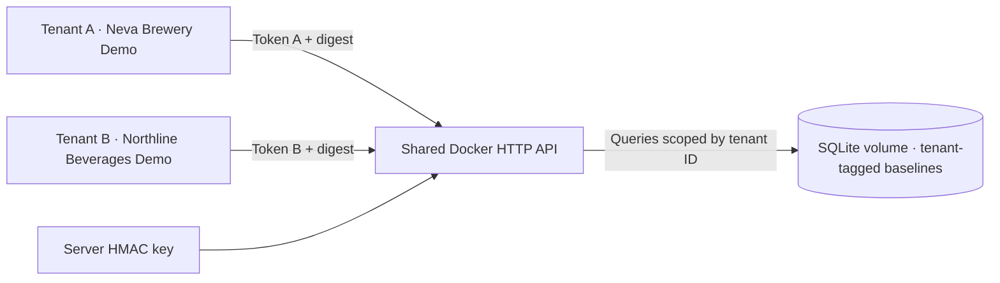

# Practical Work 5 — Artifact Integrity Lab

## Service idea

Baltika operates breweries in several cities, making it a concrete case for considering how a manufacturer could verify the files used at its sites. I propose a shared service for a brewery such as Baltika and an independent beverage producer that repeatedly need to check whether inspection models and configuration files match a trusted release. Each organisation registers the SHA-256 digest of a trusted file and later checks candidate digests when a file is updated or deployed. A customer with more inspection lines could pay for a plan that stores more trusted baselines. Baltika provides the public industry context. Neva Brewery Demo and Northline Beverages Demo are the independent fictional organisations used in the prototype.

Public company context from [Baltika's production sites page](https://corporate.baltika.ru/company/production/).

## Workflow and records

1. A release engineer hashes a known-good model or configuration file locally and sends its name and digest with the organisation's bearer token. The server checks the plan allowance and registers the approved baseline.
2. The engineer lists the organisation's baselines and retrieves one by its ID.
3. The engineer hashes the deployment candidate and sends its digest for verification against that baseline. A match returns HTTP 200 and `allow`. A mismatch returns HTTP 422 and `reject`.

The prototype supports creating, listing, reading and verifying baselines. A baseline stores its ID, tenant ID, label, SHA-256 digest, creation time and HMAC tag. The tenant configuration holds its plan and demo token. Files are hashed by the client, and the API stores digest records.

## Architecture and tenant isolation

The API maps a verified bearer token to tenant A or B. The server assigns ownership on create and filters read, list and verification lookups by that tenant ID. A read or verification request for a foreign ID returns the same HTTP 404 as an unknown ID. The HMAC tag authenticates the stored baseline using an application key outside the database.

## Plans

| Plan | Demo tenant | Stored baselines |
| --- | --- | ---: |
| Basic | A | 2 |
| Pro | B | 5 |

A successful creation consumes one slot. The server counts the tenant's rows and inserts the new record in a single SQLite write transaction. At the limit it returns HTTP 409 with `plan_limit_reached`, current usage and the allowance. Listing, reading and verifying keep the count unchanged.

## Acceptance checks

| Check | Starting conditions | Test action | Expected result |
| --- | --- | --- | --- |
| Normal use | A and B can authenticate and each has an unused slot. | Each registers, reads and lists its own baseline. Verify matching and changed digests. | HTTP 201 on create and 200 on owned read and list. Each list contains only its own baseline. Matching digest gets 200 allow. Changed digest gets 422 reject. |
| Tenant isolation | B owns a baseline. A knows its ID. | B reads it. A tries to read and verify the same ID. B reads it again. | A gets 404 for both requests. B gets 200 before and after with the same record. |
| Plan limit | Each has one baseline after the normal-use check. | A and B both try to add a second and third baseline. Compare A's list before and after its third request. | A reaches 2/2 and its third create gets 409. The list stays identical. B's third create gets 201 and its usage reaches 3/5. |
